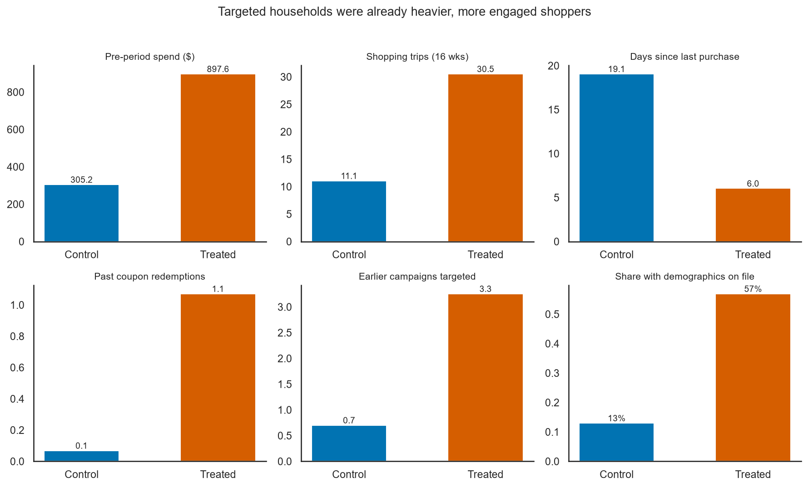
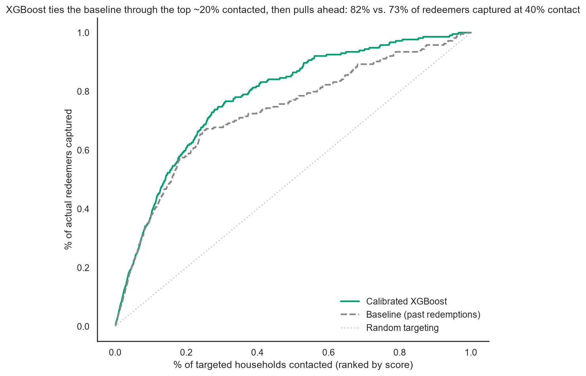
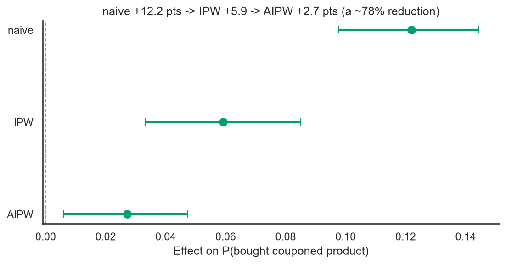
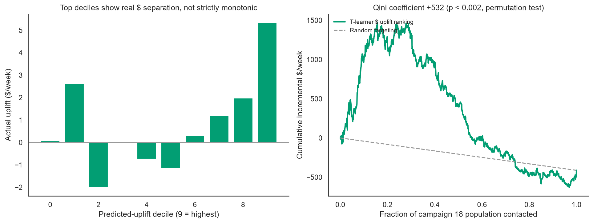

# Coupon Redemption Propensity & Uplift Model

Who should get a coupon, and does the coupon actually change their behavior? A causal
inference and ML project on 2,469 households and 27 grocery coupon campaigns, built to
mirror the targeting questions behind an Amex Business Analyst – Offers role.

**Author:** Annapurna Zutshi

## Business problem

Retail and card-offer teams routinely decide who to target with a coupon or offer. Two
questions get conflated that shouldn't be:

1. **Who is likely to redeem/respond** if targeted? (a prediction problem)
2. **Who actually changes their behavior because of the offer**, versus who would have
   bought anyway? (a causal inference problem — "incrementality")

Optimizing for (1) alone tends to reward *free-riders*: heavy, already-engaged customers
who redeem a lot but would have bought the product regardless. This project builds both
models side by side on the same data, so the gap between "likely to redeem" and
"actually incremental" is explicit rather than assumed.

## Data

[Dunnhumby "The Complete Journey"](https://www.8451.com/area51/) via
[`completejourney_py`](https://github.com/bradleyboehmke/completejourney_py): 2,469
households, 53 weeks, 27 coupon campaigns. Three Type A campaigns (8, 13, 18, ~1,100
targeted households each) are the focus — trained on campaigns 8 and 13, evaluated
out-of-time on campaign 18. Full table-by-table data dictionary is at the bottom of this
file.

## Approach, by stage

| Stage | Notebook | What it does |
|---|---|---|
| 1 | `01_data_load.ipynb` | Load all 8 raw tables, sanity-check campaign/redemption counts, build the data dictionary |
| 2 | `02_features.ipynb` | Build the (household, campaign) modelling table — every feature computed only from the 16-week *pre-campaign* window, no leakage |
| 3 | `03_segmentation.ipynb` | K-means behavioral segmentation (k=5), profiled and cross-tabbed against targeting/redemption |
| 4 | `04_propensity.ipynb` | Redemption propensity model — baseline rule vs. logistic regression vs. LightGBM vs. XGBoost, selected on cross-validation, calibrated, explained with SHAP |
| 5 | `05_uplift.ipynb` | Causal/uplift model — propensity-based overlap trimming, covariate balance (love plot), naive vs. IPW vs. doubly-robust (AIPW) effect estimates with bootstrap CIs, a T-learner evaluated with Qini curves and a permutation test |
| 6 | `06_results_summary.ipynb` | Reloads every saved output (no models refit) and exports the figures and numbers below |

See [CLAUDE.md](CLAUDE.md) for the full design rationale (campaign selection, train/test
split, why a 16-week lookback, etc.).

## Key results

Full numbers (every count, metric, effect estimate and p-value used anywhere in this
project) are in [`reports/results_summary.md`](reports/results_summary.md), generated
directly from saved model outputs — not retyped — so it, this README, and any deck agree
by construction.

**Targeting is not random, and it's predictable.** Campaign 18 treated households had
pre-period spend nearly 3x control's ($898 vs. $305), 3x the shopping trips (30.5 vs.
11.1), and far more prior coupon/campaign history — the same imbalance shows up across
every campaign and every modelling stage.



**The propensity model ties the naive heuristic early, then pulls ahead.** Calibrated
XGBoost and a "rank by past redemptions" baseline tie on top-decile lift (3.72x, both)
and capture almost the same share of redeemers through the top ~20% contacted (60.8% vs.
57.9%). Beyond that XGBoost pulls away — 81.8% vs. 72.9% of redeemers captured at 40%
contact — and wins outright on ROC-AUC (0.844 vs. 0.780) and PR-AUC (0.629 vs. 0.563).



**Adjusting for selection bias cuts the estimated effect by ~78%.** The naive
treated-vs-control difference in "bought a couponed product" (**+12.2 points**, 95% CI
[9.8, 14.4]) drops to **+5.9 points** (CI [3.3, 8.5]) under inverse-propensity weighting
and to **+2.7 points** (CI [0.6, 4.7]) under a doubly-robust AIPW estimator — the
headline effect size for this project: still positive, but a much smaller, more
defensible number than the naive comparison suggests.



**A T-learner on a less-saturated dollar outcome finds real, validated heterogeneity.**
Ranking households by predicted change in weekly coupon-category spend produces a Qini
coefficient of **+532** — peaking at **16% of the population contacted, $1,474/week**
cumulative incremental spend — **a result a 500-shuffle permutation test shows would
occur by chance less than 1 time in 500 (p < 0.002)**. The same ranking on the original
binary "did they buy anything" outcome *failed* to beat random, because that outcome is
96-97% saturated for treated households — there's little heterogeneity left to detect.



## Limitations

- **This is observational data, not a randomized experiment.** Every causal estimate
  here rests on the unconfoundedness assumption — that the measured features capture
  everything that drives both targeting and purchase. That's an assumption, not something
  the data can verify.
- **Residual imbalance survives adjustment.** Inverse-propensity weighting reduces the
  number of badly-imbalanced features from 50 of 64 to 21 of 64, but doesn't fully close
  the gap — several behavioral variables (especially prior campaign exposure) remain
  meaningfully imbalanced even after weighting.
- **Overlap is weak for three of the five segments.** The "Loyal big-basket" segment has
  only 25 control households (91% targeted); "Lapsing" and "Light, occasional" segments
  have only 56–60 treated households each. Any uplift estimate for these three segments
  rests on a thin sample on one side or the other and should be read with that in mind —
  only "Rising spenders" and "Frequent fuel & grocery shoppers" have good balance on both
  sides.
- **One campaign, one test.** Campaign 18 is a single out-of-time evaluation. Nothing
  here has been cross-checked against a second held-out campaign, let alone a randomized
  one.

## Recommendation

Before reallocating targeting budget on the strength of the uplift model: **run a
randomized 10% holdout on a future campaign** (truly random assignment, not
propensity-based) and check whether the $-outcome T-learner's top-ranked "persuadable"
households actually show higher incremental spend than a random sample. The permutation
test result is real statistical evidence the ranking has found something — it is not,
on its own, sufficient grounds to deploy at scale. If the holdout confirms the signal,
pilot uplift-based targeting on a limited share of the next campaign before a full
rollout.

## Repo structure

```
coupon-uplift-model/
├── CLAUDE.md                      # full project design & working notes
├── README.md                      # this file
├── requirements.txt
├── src/
│   └── features.py                # reusable feature-engineering functions (Stage 2)
├── notebooks/
│   ├── 01_data_load.ipynb
│   ├── 02_features.ipynb
│   ├── 03_segmentation.ipynb
│   ├── 04_propensity.ipynb
│   ├── 05_uplift.ipynb
│   └── 06_results_summary.ipynb
├── data/                          # gitignored — regenerated by notebooks 01-02
│   ├── raw/                       # 8 raw tables, from notebook 01
│   └── processed/                 # model_table, segments, scores, from notebooks 02-05
└── reports/
    ├── results_summary.md         # every headline number, single source of truth
    └── figures/                   # presentation-ready PNGs, from notebook 06
```

## How to run

```bash
python -m venv .venv
.venv\Scripts\activate            # Windows
pip install -r requirements.txt
jupyter lab
```

Run the notebooks in order (01 → 06). Notebooks 01-02 regenerate `data/` (gitignored);
03-05 build on `data/processed/`; 06 reloads everything from disk and refits nothing, so
it's safe to re-run any time after 01-05 have been run once.

## Data dictionary

Raw tables are saved as parquet in `data/raw/` by [notebooks/01_data_load.ipynb](notebooks/01_data_load.ipynb)
(gitignored — re-run the notebook to regenerate them).

### `transactions` (1,469,307 rows)

Every item scanned at checkout.

| Column | Type | Description |
|---|---|---|
| household_id | int64 | Household that made the purchase |
| store_id | int64 | Store where the purchase occurred |
| basket_id | int64 | Receipt/basket identifier — groups items bought together |
| product_id | int64 | Product purchased, joins to `products` |
| quantity | int64 | Units purchased |
| sales_value | float64 | Amount paid for the item, after discounts |
| retail_disc | float64 | Discount from a non-coupon promotion (e.g. shelf price cut) |
| coupon_disc | float64 | Discount from a manufacturer or store coupon |
| coupon_match_disc | float64 | Store match of a manufacturer coupon discount |
| week | int64 | Week number of the transaction (1–53) |
| transaction_timestamp | datetime64 | Date/time of the transaction |

### `demographics` (801 rows)

Self-reported household demographics — voluntary, so only ~32% of households are covered.

| Column | Type | Description |
|---|---|---|
| household_id | int64 | Household identifier |
| age | str | Age bracket of the household head |
| income | str | Household income bracket |
| home_ownership | str | Homeowner / renter / unknown |
| marital_status | str | Marital status |
| household_size | str | Number of household members (bucketed) |
| household_comp | str | Household composition (e.g. "2 Adults No Kids") |
| kids_count | str | Number of kids (bucketed) |

### `products` (92,331 rows)

Product catalog.

| Column | Type | Description |
|---|---|---|
| product_id | int64 | Product identifier |
| manufacturer_id | int64 | Manufacturer identifier |
| department | str | Department (e.g. GROCERY, DRUG GM) |
| brand | str | Private label or National brand |
| product_category | str | Category within department |
| product_type | str | Finer-grained product type |
| package_size | str | Package size/unit description |

### `campaigns` (6,589 rows)

Which households were targeted by which campaigns.

| Column | Type | Description |
|---|---|---|
| campaign_id | int64 | Campaign identifier, joins to `campaign_descriptions` |
| household_id | int64 | Household targeted by this campaign |

### `campaign_descriptions` (27 rows)

Metadata for each of the 27 campaigns.

| Column | Type | Description |
|---|---|---|
| campaign_id | int64 | Campaign identifier |
| campaign_type | str | Campaign type: Type A, B, or C |
| start_date | datetime64 | Campaign start date |
| end_date | datetime64 | Campaign end date |

### `promotions` (20,940,529 rows)

Weekly in-store/mailer promotional placement, independent of individual households.

| Column | Type | Description |
|---|---|---|
| product_id | int64 | Product on promotion |
| store_id | int64 | Store where the promotion ran |
| display_location | str | In-store display location code |
| mailer_location | str | Mailer placement code |
| week | int64 | Week number of the promotion |

### `coupons` (116,204 rows)

Which coupons (by UPC) belong to which campaign and cover which products.

| Column | Type | Description |
|---|---|---|
| coupon_upc | int64 | Coupon UPC/barcode |
| product_id | int64 | Product the coupon applies to |
| campaign_id | int64 | Campaign the coupon belongs to |

### `coupon_redemptions` (2,102 rows)

Actual coupon redemption events — only possible for households targeted by a campaign.

| Column | Type | Description |
|---|---|---|
| household_id | int64 | Household that redeemed the coupon |
| coupon_upc | int64 | Coupon redeemed, joins to `coupons` |
| campaign_id | int64 | Campaign the redemption belongs to |
| redemption_date | datetime64 | Date of redemption |
